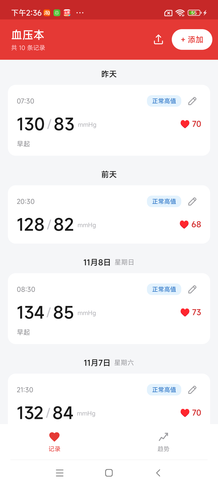
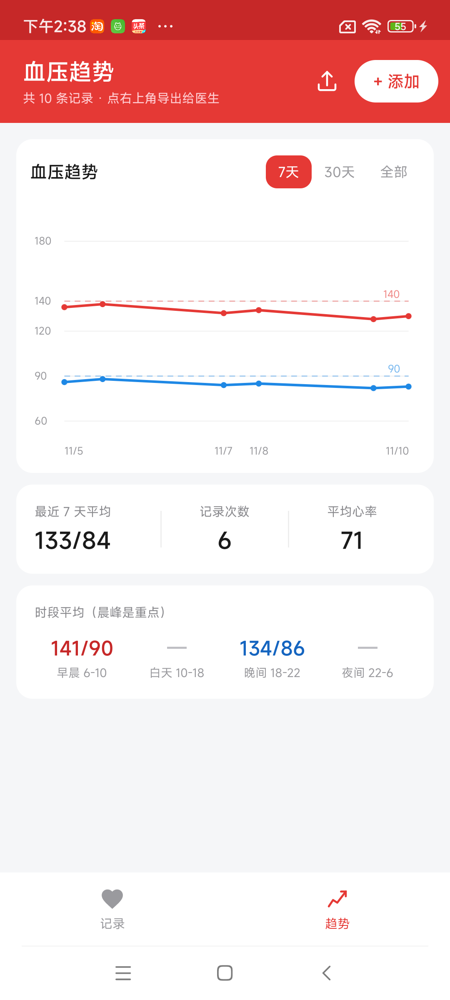
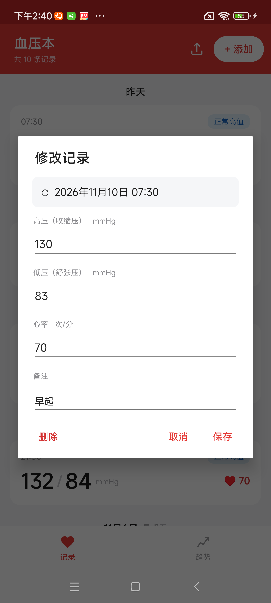

# 血压本 BpNote

一个极简的安卓血压记录 App：记录高压、低压、心率，看趋势、算时段、导出给医生。

**零第三方依赖** —— 不用 androidx，不用 Gradle，纯 Java + Android Framework API，靠 `aapt2 + javac + d8` 手工构建，APK 只有 41 KB。

---

## 功能

### 记录

- 高压（收缩压）、低压（舒张压）、心率、测量时间（年月日时分）、备注
- 按日期分组显示：「今天 / 昨天 / 前天 / 11月8日 星期日」
- 每条记录自动标注血压分级，颜色区分

| 分级 | 高压 | 低压 | 颜色 |
|---|---|---|---|
| 正常 | < 120 | < 80 | 绿 |
| 正常高值 | 120–139 | 80–89 | 蓝 |
| 1 级高血压 | 140–159 | 90–99 | 橙 |
| 2 级高血压 | 160–179 | 100–109 | 深橙 |
| 3 级高血压 | ≥ 180 | ≥ 110 | 红 |

> 按《中国高血压防治指南》分级，取高压/低压中更严重的那一级。

### 三种修改入口

同一个菜单可以从三条路打开，照顾不同习惯：

- **点击**卡片 → 直接进编辑
- **长按**卡片 → 菜单「修改数值 / 删除这条」
- **左滑**卡片 → 同一个菜单

### 趋势

独立 Tab，7 天 / 30 天 / 全部可切换：

- 高压红线、低压蓝线
- 140 / 90 参考虚线，一眼看出是否压线
- X 轴按真实时间比例分布

### 时段统计

按测量时间分成四段算平均，**晨峰高血压**（早晨 6–10 点血压骤升）是心脑血管事件的重要预警信号：

| 时段 | 范围 |
|---|---|
| 早晨 | 6:00 – 10:00 |
| 白天 | 10:00 – 18:00 |
| 晚间 | 18:00 – 22:00 |
| 夜间 | 22:00 – 6:00 |

超标自动标红。

### 导出 CSV

右上角上传图标 → 选全部 / 近 7 天 / 近 30 天 → 生成 CSV 并调起系统分享（可发微信、邮件，或存到文件管理器）。

- 带 **UTF-8 BOM**，用 Excel 或 WPS 打开中文不乱码
- 末尾附自动统计：平均、最高、最低

```
日期,时间,高压(mmHg),低压(mmHg),心率(次/分),分级,备注
2026-11-10,07:30,130,83,70,正常高值,早起
2026-11-09,20:30,128,82,68,正常高值,

统计,共 10 条
平均,133/84 mmHg,平均心率 71 次/分
最高,152/98 mmHg
最低,128/82 mmHg
```

---

## 构建

### 环境要求

| 组件 | 版本 | 说明 |
|---|---|---|
| JDK | 21 | |
| Android SDK Build-Tools | **35.0.0** | 34 的 d8 处理匿名内部类会崩 |
| Android Platform | android-34 | 只用其 android.jar |
| keystore | 任意 debug keystore | |

### 一键构建

```powershell
# 1. 改 build.ps1 顶部的路径
$SDK    = "C:\path\to\android-sdk"
$JAVA_HOME = "C:\path\to\jdk-21"
$KEYSTORE  = "C:\path\to\debug.keystore"

# 2. 构建
powershell -File .\build.ps1
```

产物：`BpNote.apk`

构建流程：`aapt2 compile` → `aapt2 link` → `javac` → `jar` → `d8` → 塞 dex → `zipalign` → `apksigner`

### 生成 debug keystore（如果没有）

```bash
keytool -genkey -v -keystore debug.keystore -storepass android \
  -alias androiddebugkey -keypass android -keyalg RSA -keysize 2048 \
  -validity 10000 -dname "CN=Android Debug,O=Android,C=US"
```

---

## 安装

APK 在 [release/](release/) 目录，或直接下载：

```
release/血压本_v1.3.apk
```

传到手机点安装即可（需要允许「安装未知来源应用」）。

---

## 数据存储

所有记录存在应用私有目录，**不需要任何存储权限**：

```
Android/data/com.meownote.bp/files/BpNote/records.json
```

格式：

```json
[
  {
    "id": "c2d79ede3e44",
    "time": 1794377885054,
    "sbp": 130,
    "dbp": 83,
    "hr": 70,
    "note": "早起"
  }
]
```

换手机时把这个文件拷出来即可迁移。

> ⚠️ 数据只存在本机，没有云同步。卸载 App 会一起删掉，建议定期导出 CSV 备份。

---

## 代码结构

```
src/com/meownote/bp/
├── MainActivity.java   界面、Tab 切换、列表适配器、添加/编辑对话框
├── Record.java         数据模型 + 血压分级 + 时间格式化
├── Store.java          JSON 单文件读写
├── TrendView.java      自绘折线图（Canvas）
├── Exporter.java       CSV 生成
└── FileProvider2.java  极简文件共享 Provider（替代 androidx FileProvider）
```

约 1200 行 Java。

### 几个实现要点

**不用 Fragment 做多页**：`FrameLayout` 里放两个平级容器，`setVisibility` 互斥切换。状态天然共享，没有生命周期和回传的麻烦。

**手势用位移判定而非 fling**：`GestureDetector.onFling` 依赖抬手瞬间的速度，自动化环境和某些设备上判不出来。改成 `onTouch` 里按位移判定，确认后立刻消费事件，避免又触发点击。

**CSV 必须带 BOM**：否则 Excel 按本地编码解析，中文全乱。`sb.append('\uFEFF')`

**列表项 margin 无效**：`ListView` 的 item 用 `AbsListView.LayoutParams`，`layout_marginBottom` 被忽略。要让卡片有间距，得在外层套一个透明容器加 `paddingBottom`。

---

## 截图

| 记录（按日期分组） | 趋势 | 编辑 |
|---|---|---|
|  |  |  |

---

## License

MIT
